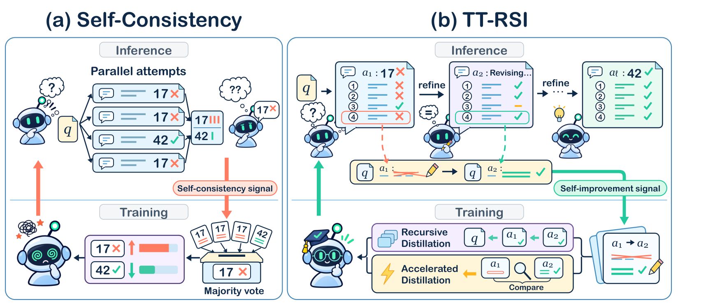

<div align="center">

<h1>Beyond Self-Consistency:<br>Recursive Self-Improvement at Test Time</h1>

<p>
Jianyu Wu<sup>1,2</sup>&nbsp;&nbsp;
Yizhou Wang<sup>2,3</sup>&nbsp;&nbsp;
Encheng Su<sup>2,4</sup>&nbsp;&nbsp;
Jinouwen Zhang<sup>2</sup>&nbsp;&nbsp;
Pengze Li<sup>2,5</sup>
<br>
Lintao Wang<sup>2,6</sup>&nbsp;&nbsp;
Chen Tang<sup>2,3</sup>&nbsp;&nbsp;
Aoran Wang<sup>2</sup>&nbsp;&nbsp;
Wanli Ouyang<sup>3</sup>&nbsp;&nbsp;
Shixiang Tang<sup>2,3,*</sup>
</p>

<p><sub>
<sup>1</sup>Shanghai Jiao Tong University&nbsp;&nbsp;
<sup>2</sup>Shanghai Artificial Intelligence Laboratory&nbsp;&nbsp;
<sup>3</sup>The Chinese University of Hong Kong
<br>
<sup>4</sup>University of Science and Technology of China&nbsp;&nbsp;
<sup>5</sup>Fudan University&nbsp;&nbsp;
<sup>6</sup>The University of Sydney
<br>
<sup>*</sup>Corresponding author
</sub></p>

<p>
<a href="https://arxiv.org/abs/2611.30965"></a>
<a href="https://uanu2002.github.io/TT-RSI/"></a>
</p>

</div>

<p align="center">
  
</p>

## TL;DR

Test-time methods today mostly **vote**: sample independent answers, trust the majority. **TT-RSI** lets the model **improve** instead — it re-solves each question with its own previous full solution in context (**In-Context RSI**), and distills those refinements into its weights without labels (**In-Weight RSI**). Each makes the other stronger.

## Results

| Model | Base | TTPO + SC (same budget) | **TT-RSI** |
|---|:---:|:---:|:---:|
| Qwen3-1.7B | 34.84 | 44.67 | **50.48** (+15.64) |
| Qwen3-4B | 55.76 | 65.76 | **69.64** (+13.88) |
| Qwen3-8B | 60.10 | 67.58 | **72.24** (+12.14) |

Average accuracy (%) over AIME25, AIME26, HMMT25, HMMT26 and BRUMO25. TT-RSI improves the base model by **+13.89%** on average, and beats the strongest self-consistency-based method by **+4.79%** at the same test-time budget.

## Code

Coming soon.

## Citation

```bibtex
@article{wu2026ttrsi,
  title   = {Beyond Self-Consistency: Recursive Self-Improvement at Test Time},
  author  = {Wu, Jianyu and Wang, Yizhou and Su, Encheng and Zhang, Jinouwen and
             Li, Pengze and Wang, Lintao and Tang, Chen and Wang, Aoran and
             Ouyang, Wanli and Tang, Shixiang},
  journal = {arXiv preprint arXiv:2611.30965},
  year    = {2026}
}
```
